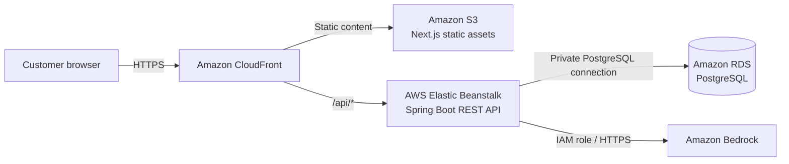
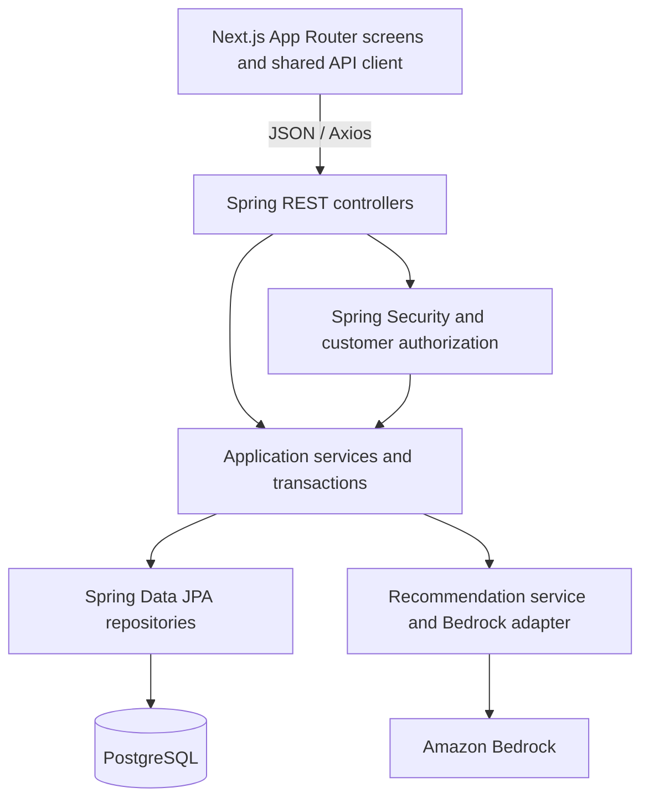

# HealthDekho Architecture

## 1. Purpose

This document defines the application structure and a deliberately simple AWS deployment for the requirements in [spec.md](./spec.md).

### Technology

- Frontend: Next.js (React App Router), TypeScript, Axios
- Backend: Java 21, Spring Boot 3.5.7, Spring Security, Spring Data JPA, Spring AI
- Database: PostgreSQL on Amazon RDS
- AWS hosting: Amazon S3, Amazon CloudFront, AWS Elastic Beanstalk, Amazon Bedrock

The frontend is a Next.js application. For the planned AWS deployment it will be exported/built as static assets where supported by the selected routing approach and hosted on S3/CloudFront. The backend is a Spring Boot application deployed to Elastic Beanstalk. RDS stores application data. Bedrock is used only for catalog-grounded, advisory recommendations. The current implementation epic runs Next.js locally and defers AWS deployment decisions to the production-readiness phase.

## 2. AWS Deployment



### Service responsibilities

| Service | Responsibility |
|---|---|
| Amazon S3 | Stores the built Next.js static assets. The bucket is private; CloudFront is the public content endpoint. |
| Amazon CloudFront | Serves the frontend over HTTPS and forwards `/api/*` requests to the Elastic Beanstalk environment. |
| AWS Elastic Beanstalk | Deploys and runs the Spring Boot application. Elastic Beanstalk manages the application environment and its underlying compute and load balancer. |
| Amazon RDS for PostgreSQL | Stores customer, product, policy, installment, payment, and recommendation data. |
| Amazon Bedrock | Provides model inference for recommendations through the backend. |

Keep the first deployment within these services. Do not add ECS, EKS, API Gateway, Cognito, or a separate microservice layer unless a later requirement justifies the added operational overhead.

### Request flow

1. A customer opens the CloudFront URL.
2. CloudFront retrieves frontend assets from the private S3 origin.
3. The Next.js app sends REST requests to `/api/*` on the same CloudFront domain.
4. CloudFront forwards those requests to the Elastic Beanstalk environment.
5. The Spring Boot API authenticates and authorizes the customer, applies business rules, and reads or writes PostgreSQL data in RDS.
6. For a recommendation request, the backend sends only eligible product candidates and relevant preferences to Bedrock, validates the response against those candidates, and persists the validated result.

CloudFront must forward the API's required HTTP methods, authorization/cookie headers, and query strings to the backend. Cache API responses only when explicitly safe; default API behavior should not cache customer-specific data.

## 3. AWS Environment Boundaries

- Use one AWS region for the application, RDS, and Bedrock model access unless a documented requirement says otherwise.
- Place the Elastic Beanstalk environment and RDS instance in the same VPC.
- Keep RDS private with public access disabled. Permit PostgreSQL traffic only from the Elastic Beanstalk instance security group.
- Use HTTPS for CloudFront-to-client and CloudFront-to-API traffic.
- Use an Elastic Beanstalk instance profile with least-privilege access to Bedrock and any required runtime configuration.
- Keep database credentials and other secrets out of source control and built frontend files. Supply them through protected deployment configuration; use AWS Secrets Manager if secret rotation or centralized management is required.
- Use separate development and production environments/configuration. Do not use production customer data in development.
- Enable RDS automated backups and encryption at rest. Set backup retention to meet the product's recovery and retention requirements.

The simplest production-ready layout is an Elastic Beanstalk load-balanced environment with its load balancer in public subnets, application instances in private subnets, and RDS in private subnets. For a short-lived development environment, a single-instance Beanstalk environment may be used, while RDS should remain private.

## 4. Application Architecture



### Backend responsibilities

- **Controllers:** REST routes, request validation, DTO binding, and HTTP status mapping. No business calculations.
- **Services:** Business rules, authorization coordination, transaction boundaries, and orchestration.
- **Repositories:** PostgreSQL access and efficient, paginated queries.
- **Entities:** Persistence model only; never return JPA entities directly from an API.
- **DTOs:** Request and response contracts, preferably Java records.
- **Recommendation integration:** Prompt construction, Bedrock invocation, typed response parsing, candidate validation, and provider metadata capture.

Use `BigDecimal` for money and the Java Time API for calendar dates. Policy registration and payment processing must be transactional. Authentication identity for customer-owned operations comes from the authenticated principal, never a request-supplied customer ID.

### Frontend areas

- Sign-in
- Customer dashboard and policy list
- Product discovery and registration
- Recommendations
- Policy details, installments, and payment history
- Policy search

Use one shared Axios client for API requests and common error handling. Each screen should handle loading, empty, success, and error states. The server remains authoritative for eligibility, balances, status, and financial calculations.

## 5. Repository Structure

Use a simple monorepo with separate frontend and backend projects. The frontend uses Next.js App Router:

```text
health-sure/
├── frontend/
│   ├── public/
│   ├── src/
│   │   ├── app/                 # Next.js App Router pages and layouts
│   │   ├── components/          # Shared UI components
│   │   ├── features/
│   │   │   ├── auth/
│   │   │   ├── dashboard/
│   │   │   ├── products/
│   │   │   ├── recommendations/
│   │   │   ├── policies/
│   │   │   ├── payments/
│   │   │   └── search/
│   │   ├── lib/
│   │   │   └── api/             # Axios client and API functions
│   │   ├── hooks/
│   │   ├── types/               # Frontend request/response types
│   │   └── utils/
│   ├── .env.example             # Non-secret local configuration names only
│   └── package.json
├── backend/
│   ├── src/
│   │   ├── main/
│   │   │   ├── java/com/healthdekho/
│   │   │   │   ├── config/
│   │   │   │   ├── controller/
│   │   │   │   ├── dto/
│   │   │   │   ├── entity/
│   │   │   │   ├── exception/
│   │   │   │   ├── repository/
│   │   │   │   ├── security/
│   │   │   │   ├── service/
│   │   │   │   └── recommendation/
│   │   │   └── resources/
│   │   │       ├── application.yml
│   │   │       └── db/migration/ # Versioned schema migrations
│   │   └── test/
│   │       ├── java/com/healthdekho/
│   │       └── resources/
│   ├── .ebextensions/           # Only when Beanstalk environment config needs it
│   ├── Procfile                 # Spring Boot launch command for Beanstalk
│   ├── .env.example             # Non-secret local configuration names only
│   └── pom.xml
├── infra/
│   └── aws/
│       └── README.md            # Manual AWS setup and deployment steps initially
├── .gitignore
├── PRD.md
├── spec.md
└── architecture-spine.md
```

Keep deployment automation minimal at first. `infra/aws/README.md` documents the S3/CloudFront distribution, Elastic Beanstalk environment, and RDS setup. Add infrastructure-as-code only when the team is ready to maintain it. Never commit real `.env` files, access keys, database passwords, or Bedrock credentials.

The structure is a target for implementation; it does not imply that application source code or infrastructure has already been created.

## 6. Data and Business Integrity

Use the entities and constraints described in `spec.md`:

- Customer
- Insurance product
- Customer policy
- Premium installment
- Premium payment
- Recommendation request
- Recommendation item

Core constraints and behaviors:

- Consistent identifier type and explicit foreign keys.
- Unique customer/product registration, policy number, installment sequence per policy, and payment transaction reference.
- Store policy financial terms as a snapshot so later catalog changes do not alter existing policies.
- Keep payment transactions as persistent history and update installment/policy totals in the same transaction.
- Use database constraints as well as application validation for important invariants.
- Use schema migrations in `backend/src/main/resources/db/migration/`.
- Enforce customer ownership in backend queries and service methods.

## 7. API and Security

Keep the REST contract and error response format in `spec.md`. The Next.js app calls the API through the CloudFront `/api/*` behavior. The API returns JSON DTOs, ISO-8601 dates, decimal money values, and bounded or paginated search results.

Apply Spring Security to authenticated endpoints using 30-minute JWT access tokens held in HttpOnly cookies, as selected in `spec.md`; there is no refresh token. Logout clears the cookie. Do not expose tokens to browser JavaScript or local storage. Configure `SameSite=Lax`, production `Secure` cookies, and CSRF protection. Restrict CORS to the deployed frontend origin if cross-origin calls are used. Do not expose stack traces, credentials, password hashes, access tokens, or provider details to clients or logs.

Payment requests require the agreed `Idempotency-Key` header so retries cannot create duplicate transactions. The server generates a stable transaction reference. Apply the confirmed once-per-installment penalty accounting consistently.

## 8. Configuration and Operations

Configuration is supplied per environment, not hard-coded:

- RDS connection URL, username, and password
- JWT signing secret, 30-minute expiry, cookie flags, and CSRF settings
- Bedrock region, model identifier, and prompt version
- CORS/frontend origin
- Logging level and application port

Use the Elastic Beanstalk environment configuration and instance role for runtime settings and AWS access. The backend calls Bedrock using its instance role; do not store static AWS access keys in the application. Required configuration must fail visibly at startup without logging secret values.

Use Elastic Beanstalk health checks and CloudWatch logs/metrics to monitor application health, HTTP failures, database connectivity, and Bedrock errors/latency. Log request IDs and safe error codes, but minimize customer personal data in logs. Provide a clear `503` response when Bedrock is unavailable; never fabricate a successful recommendation.

## 9. Deployment Flow

1. Build and test the Next.js frontend.
2. Upload the generated static assets to the private S3 bucket.
3. Deploy the Spring Boot artifact to the Elastic Beanstalk environment.
4. Run database schema migrations as a controlled deployment step.
5. Configure CloudFront with S3 as the static origin and Elastic Beanstalk as the `/api/*` origin.
6. Verify frontend delivery, API health, database connectivity, and a recommendation request.

For frontend releases, invalidate CloudFront only when required; prefer versioned/hash-named assets. For backend releases, use Elastic Beanstalk's supported deployment policy and verify health before considering the deployment complete. Maintain RDS backups and test recovery rather than relying only on deployment rollback.

## 10. Decisions and Follow-up

Business behavior for authentication, search ownership, payment recording, duplicate registration, date calculations, penalties, idempotency, and recommendation failure handling is recorded in `spec.md`. Production availability, performance, accessibility, retention, and recovery targets remain for the production-readiness phase.

Keep each decision consistent across UI, API, database constraints, and tests.
